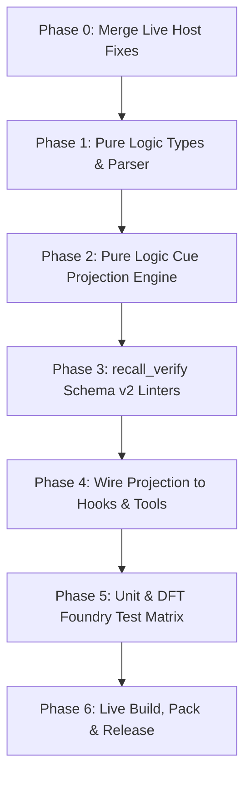

# Phosphene Axiomatic Implementation Plan: `oc-memory-recall` Schema v2 (Issue #58)

**Target Issue:** [#58](https://github.com/FlowFeel/openclaw-test-harness/issues/58) — *oc-memory-recall: frontmatter schema v2 — predicate order/placement cue grammar*  
**Branch:** `feat/memory-recall-schema-v2`  
**Base Architecture:** Phosphene Design-for-Testability (DFT) Axiomatics (A1–A6) & OpenClaw Plugin Foundry

---

## 1. Architectural Posture & Invariants

### 1.1 The Six Phosphene DFT Axioms

| Axiom | Phosphene Rule | Schema v2 Implementation Enforcement |
|---|---|---|
| **A1: Pure Logic / I/O Separation** | Logic files (`*-logic.ts`) import no I/O modules (`node:fs`, `node:path`); `index.ts` imports no `node:fs` directly. | All v2 frontmatter parsing, cue projection, kind compression mapping, and predicate linting live in `memory-recall-logic.ts` as pure, stateless functions. File reads/scans stay isolated in `memory-recall-io.ts`. |
| **A2: Determinism as Correctness** | Logic functions are pure mathematical transformations. No un-injected `Date.now()`, `Math.random()`, or `new Date()` in logic. | Time is injected via explicit `nowMs` or ISO timestamp parameters for `updated` staleness calculations. Given identical note objects and context, projection output is byte-identical. |
| **A3: Manifest Conformance** | Declared tools/hooks in `openclaw.plugin.json` match registered tools/hooks in `index.ts`. | Configuration schema in `openclaw.plugin.json` updated with any new tunable parameters while maintaining exact schema validation parity. |
| **A4: Explicit DFT Invariants** | Every source file declares `@dft` or `@invariants` docblock explaining contracts. | All new v2 types, parsing functions, projection engines, and linter predicates are fully documented with invariant declarations. |
| **A5: Protocol Doubles, Not Mocks** | Integration tests use real in-memory Protocol doubles, never monkey-patched `vi.fn()` mocks. | Tests use `FakePluginApiClient`, in-memory note loaders, and synthetic tool events. |
| **A6: CheckResult Pattern** | Decisions carry their own proof; mutating or decision logic returns structured report objects. | Projection and verification return structured result types (`CueProjectionResult`, `PredicateLintResult`) detailing verdict, slot breakdown, and rejection reasons. |

---

### 1.2 Efficiency & Zero-Waste Invariants (Guarding Against Regression)

To ensure Schema v2 never adds computational overhead, token bloat, or latency:

1. **Zero Auxiliary Model Calls:**
   - All parsing, slot extraction, predicate ordering, and condition gating execute strictly as host TypeScript compute ($O(1)$ deterministic string operations).
   - Zero LLM-as-a-judge classification hops.
2. **Preserved Frontmatter Boot Gate ($O(1)$ Rejection):**
   - The `hasKindFrontmatter` gate from PR #56 remains the absolute gatekeeper before full YAML parsing. Episodic dailies, plain markdown, or unfrontmatter'd files are rejected in microseconds before hitting YAML deserialization.
3. **No Hot-Loop Regex Re-compilation:**
   - All linters, path detectors, and punctuation matchers are statically pre-compiled top-level module constants (`PREDICATE_PERIOD_REGEX`, `PATH_SHAPE_REGEX`, `IMPERATIVE_MOOD_REGEX`).
4. **Zero Token Bloat via Kind-Selected Compression:**
   - Methods and mistakes are mapped to the **skip-list** (emits 0 cue tokens).
   - Injected contexts without values in view emit **minimal BIND + POINTER only** (strips predicates to prevent negative prompt drag).
5. **Single-Scan Idempotency (`ensureScanned`):**
   - Lazy first-scan pattern ensures the disk is only read once per registry instance.

---

## 2. Core Grammar: The Three-Slot Projection

### 2.1 Fixed Slot Grammar

```text
[PREDICATE] [BIND] — see [POINTER]
```

1. **`BIND`**: The item's own words, extracted (never authored):
   - Resolution order: `note.bind` (if explicitly set) $\to$ `note.title` $\to$ First `# Heading` in note body $\to$ Basename of note file.
2. **`PREDICATE`**: Exactly one free-language clause in domain-appropriate wording:
   - Stated as a descriptive relation (licence or obligation).
   - Never imperative.
   - Max 140 characters; no sentence-internal periods.
3. **`POINTER`**: The exact relative file path (`/` or `./` shaped). Always the final token. Never an index hop.

---

### 2.2 Predicate Order Rules

Slot emission order conveys the semantic relationship without requiring a closed vocabulary:

| Predicate Type | Semantic Role | Emission Order | Example Emission |
|---|---|---|---|
| **Claim-Type** | Licence leads; asserts state difference against stale view | **PREDICATE before BIND** | `changed since this summary: the house style is now recorded; see docs/coding-style.md` |
| **Obligation / Event** | Event anchors; obligation closes | **BIND before PREDICATE** | `PR review completed, waiting for: test suite passing — you owe a step when this happens; see docs/review-policy.md` |
| **Plain (Compressed)** | Orientation or unasserted pointer | **BIND + POINTER only** | `Foundry test suite guidelines — see docs/testing-policy.md` |
| **Skip-List** | High FPR or method lookup | **Suppressed (empty)** | *(No cue line emitted)* |

---

### 2.3 Kind $\to$ Compression Matrix

| Kind Category | Kinds | Predicate Emitted? | Form Emitted |
|---|---|---|---|
| **Skip-list** | `procedure`, `workaround`, `historical_incident` (methods / mistakes) | **Never** | *(Empty / Suppressed)* |
| **Plain Reference** | `environment`, `project_status`, `glossary` (orientation) | Only if `predicate` explicitly set; else fallback to plain | `[BIND] — see [POINTER]` |
| **Full Three-Slot** | `house_style`, `authority`, `silent_trap`, `code_rule`, `domain_fact`, `user_preference`, `architectural_decision` | **Yes** (if `predicate` present and condition gated) | `[PREDICATE]: [BIND] — see [POINTER]` |
| **Event-Slot** | Open loops, pending cases (`event` defined) | **Yes** (event anchors as BIND) | `[BIND], waiting for: [EVENT] — [PREDICATE]; see [POINTER]` |

---

### 2.4 Condition Gating (Stale-in-View vs Injection)

The projection function receives a `CueContext`:
```typescript
export interface CueContext {
  arm: "file_read" | "event_push" | "tool_notes" | "resume_refresh" | "status";
  targetPath?: string;
  fileMtimeMs?: number;
  nowMs?: number;
}
```

- **File-Read Arm (M6)**: A file is being read by the agent $\to$ Stale value in view $\to$ **Predicate licensed**.
- **Context Injection / Resume Refresh (M1, M5)**: Injected into turn without file in view $\to$ **Predicate suppressed**, emit `BIND + POINTER` only (prevents the measured $-0.08$ net penalty of ungrounded claim injection).

---

## 3. Work-Item Breakdown & Phosphene Seams



---

### Phase 0: Baseline Alignment & Merge Host Fixes
- Merge `fix/memory-recall-config-via-api-pluginconfig` into `main`:
  - `api.pluginConfig` resolution.
  - `ensureScanned()` lazy initialization for tool-serving contexts.
- Rebase/merge `main` into `feat/memory-recall-schema-v2`.

### Phase 1: Pure Logic Types & Parser Expansion (`memory-recall-logic.ts`)
- **New Types**:
  - `MemoryNoteV2`: extends `MemoryNote` with optional `bind?: string`, `predicate?: string`, `event?: string`, `updated?: string`.
  - `CueContext`: defines delivery arm, watched path, file mtime, current time.
  - `CueProjectionResult`: `{ cueText: string; emitted: boolean; compression: CompressionLevel; reason?: string }`.
- **Parser Updates**:
  - Update `parseNoteFrontmatter` to extract v2 optional fields without breaking any v1 notes.
  - Validate ISO 8601 strings in `updated`.

### Phase 2: Cue Projection & Compression Engine (`memory-recall-logic.ts`)
- **Extraction Function**: `extractBindPhrase(note: MemoryNoteV2, rawContent: string): string`.
- **Classification & Gating**:
  - `getKindCompression(kind: string): CompressionLevel`.
  - `isPredicatePermitted(note: MemoryNoteV2, context: CueContext): boolean`.
- **Projection Function**:
  - `projectCueLine(note: MemoryNoteV2, context: CueContext): CueProjectionResult`.
  - Implements the exact slot ordering and punctuation conventions.

### Phase 3: `recall_verify` Linter Expansion (`memory-recall-logic.ts`)
- Lint 1: `paths` entries must resemble valid filesystem paths (must contain `/` or match repo naming convention; rejects prose descriptions).
- Lint 2: `predicate` must be a single clause (rejection on sentence-internal periods `\.[ \t]+[A-Z]`, max 140 chars).
- Lint 3: No imperative mood in `predicate` (pre-compiled regex catching command openers: `^(do not|never|always|ensure|make sure|use|avoid)\b`).
- Lint 4: `updated` must be a valid ISO 8601 timestamp.
- Lint 5: `event` warning if present without an event-driven or open-loop kind.

### Phase 4: Integration Wiring (`index.ts`)
- Update `formatFileMarker` to use `projectCueLine` with `arm: "file_read"`.
- Update `buildResumeRefreshNotice` and M1 event push to use `arm: "resume_refresh"` / `arm: "event_push"` (plain BIND + POINTER gating).
- Update `recall_verify` tool to output structured diagnostic reports detailing v2 lint failures and warnings.

### Phase 5: Verification & Foundry Test Suite
- Pure logic specs (`memory-recall-logic.spec.ts`):
  - 100% unit coverage for BIND extraction, claim vs obligation ordering, kind compression table, condition gating, and all 5 linters.
- Integration specs (`integration.spec.ts`):
  - In-memory protocol doubles verifying that file reads emit licensed predicates while resume refresh emits plain BIND + POINTER.
- Foundry Validation (`validate:foundry`):
  - Zero violations across all 6 DFT axioms.

### Phase 6: Packaging & Delivery
- Run `npm run typecheck && npm run validate:foundry && npm run build:plugins && npm run pack:plugins`.
- Commit, push to `origin/feat/memory-recall-schema-v2`, and update Issue #58.

---

## 4. Addressing the Open Questions in Issue #58

1. **BIND extraction from title/heading vs diff subject:**
   - *Resolution:* Extract from `note.bind` $\to$ `title` $\to$ first `# Heading`. Falling back to git diff subjects introduces non-deterministic I/O dependencies into what must be a pure, memory-resident lookup seam.
2. **`recall_verify` lint vs Generator refusal:**
   - *Resolution:* `recall_verify` warns and reports invalid predicates with full diagnostics. The runtime projection engine gracefully falls back to plain `[BIND] — see [POINTER]` if a predicate violates single-clause or length boundaries, preserving zero-crash safety.
3. **`updated` gating per-path:**
   - *Resolution:* Per-note `updated` ISO timestamp in v2. Multi-path per-path timestamp mapping deferred to v3 as specified.
